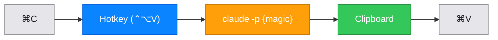
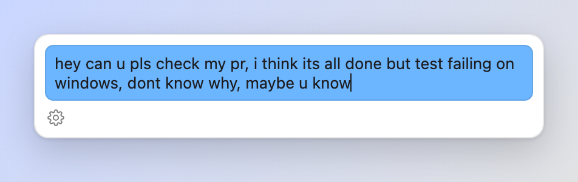
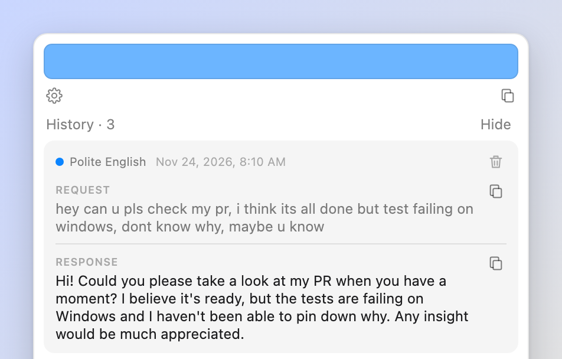
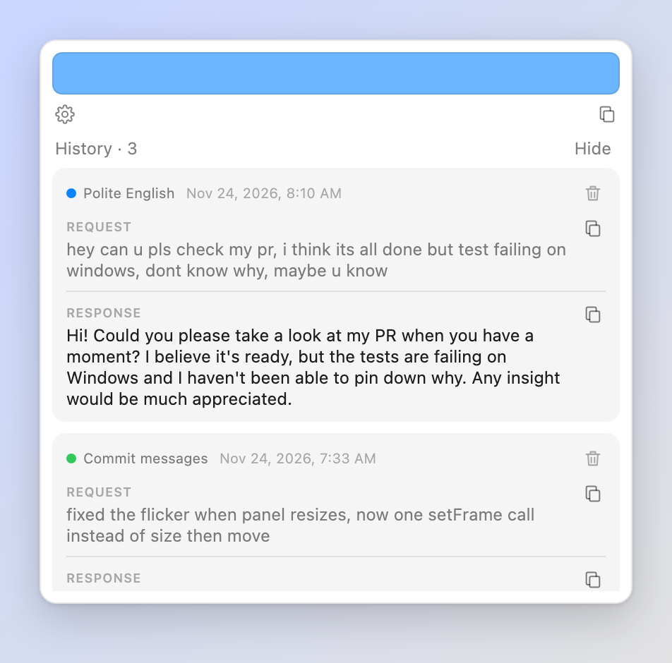
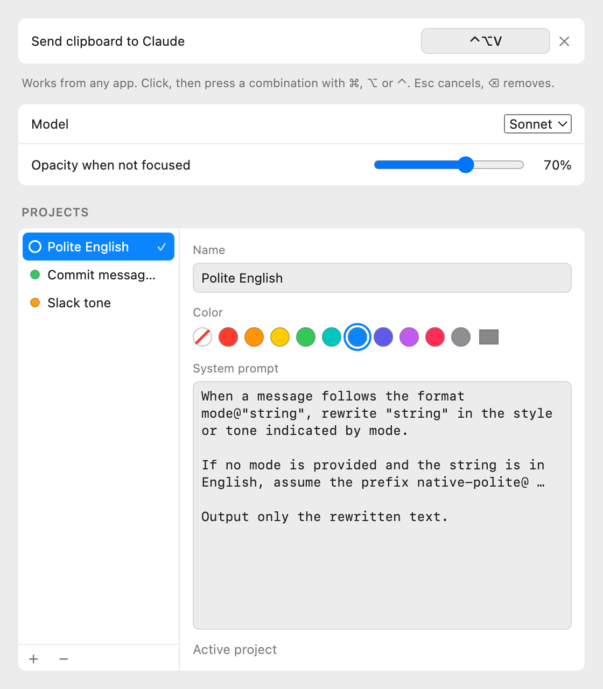

# Fast Mode



A small always-on-top panel for jobs you keep asking Claude to do the same way. Each **project** is a system prompt with a color: rewrite in polite English, write a commit message, summarize a thread, and so on.

<p align="center"></p>

**`{magic}`:** the active project's system prompt. The default one is "Rewrite the text in natural, polite English. Translate it if it's in another language. Output only the result."

**Claude's reply**, already on your clipboard:

> Hi! Could you please take a look at my PR when you have a moment? I believe it's ready, but the tests are failing on Windows and I haven't been able to pin down why. Any insight would be much appreciated.

**History:**

<p align="center"></p>

|  |  |  |
| :-: | :-: | :-: |
| idle | working | copied |

## Use

- **A global hotkey** (you pick it in Settings) sends the clipboard from any app, and the reply replaces it. You never leave the app you are in.
- **Paste** into the empty panel to send right away, or type and press **⌘↩**.
- **Esc** cancels.
- **⚙** switches the project and model, and opens history and settings.

<p align="center">
  
  
</p>

## Install

Needs [Claude Code](https://docs.claude.com/en/docs/claude-code) installed and signed in. Fast Mode runs `claude -p` with your account, so no API key is needed.

To build from source you also need Node.js and [Rust](https://tauri.app/start/prerequisites/).

```bash
npm install
```

```bash
npm run install:mac
```

On Windows or Linux use `npm run build`, and `npm run dev` while developing.
