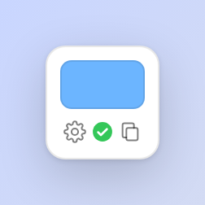
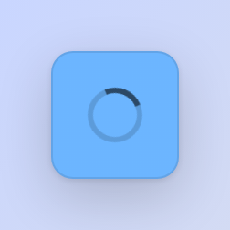

# Fast Mode

A tiny always-on-top panel that sends text to Claude and puts the answer straight on the clipboard.

You type or paste something, Claude rewrites it using a system prompt you choose, and the result is ready to paste with ⌘V. A global shortcut does the same from any app without switching windows: copy text, press ⌃⌥V, wait for the spinner, paste.

The default prompt turns rough notes (in any language) into polite, natural English. Fast Mode is not a chat: every request is a one-off rewrite.

<p align="center">
  
</p>

## How it works

Fast Mode is a [Tauri 2](https://tauri.app) app. It runs your installed [Claude Code](https://docs.claude.com/en/docs/claude-code) CLI:

```
claude -p --output-format json --system-prompt-file <active project prompt> [--model …]
```

The reply is copied to the clipboard and saved to history along with the raw JSON (cost, token usage, session). It uses your Claude Code sign-in, so there are no API keys to configure.

## The panel

When idle the panel is a 70×70 square that stays on top of all windows and Spaces. Drag it anywhere and it remembers the position. While another app is focused it fades to the opacity you set in Settings.

<table>
  <tr>
    <td align="center"><br><sub>Idle</sub></td>
    <td align="center"><br><sub>Copied ✓</sub></td>
    <td align="center"><br><sub>Hotkey request running</sub></td>
  </tr>
</table>

- **Type**, and the panel expands. **⌘↩** (Ctrl+↩ on Windows/Linux) sends, and **↩** adds a new line.
- **Paste into an empty field** to send it immediately.
- **Global shortcut** (default **⌃⌥V**) sends the current clipboard from any app without taking focus. Pressing it again during a request cancels that request and starts a new one.
- **Esc**, or a click on the spinner, cancels.
- When the answer is on the clipboard you see a green check. The copy button puts the last answer back on the clipboard.
- The input box is tinted in the active project's color, so you can tell which prompt is in use.

The ⚙ menu switches the project and model, opens history, shows the signed-in account, links to **Usage & Limits**, and opens Settings.

### History

Each entry keeps the request, the response, the project it used, and the raw CLI JSON. Click an entry to expand it. Every part has its own copy button. Up to 300 entries are kept.

<p align="center">
  
</p>

## Settings and projects

A **project** is a named system prompt with a color. Use several of them for different jobs, such as polite English, commit messages, or Slack tone, and switch between them from the ⚙ menu.

<p align="center">
  
</p>

Settings also covers:

- the global shortcut (click the field and press a combination; ✕ removes it)
- the model: Default, Haiku, Sonnet, or Opus
- the panel's opacity when it is not focused

### The default prompt

[`src-tauri/default-prompt.md`](src-tauri/default-prompt.md) is a rewrite prompt:

- `mode@"text"` rewrites `text` in the given style, for example `formal@"…"` or `short@"…"`.
- English text with no mode is rewritten in a natural, polite tone.
- Text in another language with no mode is translated into polite English.
- Lines starting with `> ` are quotes and stay unchanged.
- A message starting with `**` is a direct instruction to Claude, not text to rewrite.
- Markdown is returned raw, so it pastes as plain text.

## Requirements

- [Claude Code](https://docs.claude.com/en/docs/claude-code) installed, with `claude` on your `PATH` or in a standard install location. If you are not signed in, the panel shows a **Sign in…** link, which runs `claude auth login` in a terminal.
- To build: Node.js and a Rust toolchain ([Tauri prerequisites](https://tauri.app/start/prerequisites/)).

## Build and run

```bash
npm install
```

```bash
npm run dev
```

```bash
npm run build
```

On macOS, this builds the app, installs it to `/Applications`, and starts it:

```bash
npm run install:mac
```

## Data

Settings, projects, and history are stored as JSON in the platform data directory:

| OS | Path |
| --- | --- |
| macOS | `~/Library/Application Support/FastMode/` |
| Windows | `%APPDATA%\FastMode\` |
| Linux | `~/.local/share/FastMode/` |

## Project layout

```
src/                  panel (index.html, main.js, style.css) and settings.html
src-tauri/src/lib.rs  backend: claude CLI, clipboard, global shortcut, window handling
src-tauri/default-prompt.md
Icon/                 app icon sources
docs/screenshots/     images for this README
```
