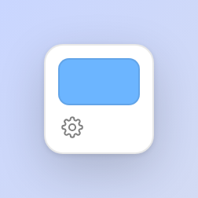

# Fast Mode


A small always-on-top panel for jobs you keep asking Claude to do the same way.

- **Each project is a system prompt**: rewrite in polite English, summarize a thread, and so on.
- **No API key needed**: it runs through Claude Code with your Claude subscription.
- **Type, paste, or use a system-wide shortcut** from any app.
- **The reply goes straight to the clipboard**, ready to paste.
- **Switch the model** (Haiku, Sonnet, Opus) from the ⚙ menu.
- **History** keeps every request and reply, with cost and token usage.


**`{magic}`:** the active project's system prompt. The default one is "Rewrite the text in natural, polite English. Translate it if it's in another language. Output only the result."

**Claude's reply**, already on your clipboard:

> Hi! Could you please take a look at my PR when you have a moment? I believe it's ready, but the tests are failing on Windows and I haven't been able to pin down why. Any insight would be much appreciated.

**History:**


|  |  |  |
| :-: | :-: | :-: |
| idle | working | copied |

## Use

- **A global hotkey** (you pick it in Settings) sends the clipboard from any app, and the reply replaces it. You never leave the app you are in.
- **Paste** into the empty panel to send right away, or type and press **⌘↩**.
- **Esc** cancels.
- **⚙** switches the project and model, and opens history and settings.


## Install

> [!WARNING]
> **macOS only.** The code has Windows and Linux branches (`src-tauri/src/platform/`), but they have never been built or run there. Expect them not to work.

Needs [Claude Code](https://docs.claude.com/en/docs/claude-code) installed and signed in. Fast Mode runs `claude -p` with your account, so no API key is needed.

**Download** the latest `.dmg` from [Releases](https://github.com/indisee/fast-mode/releases/latest) and drag Fast Mode to Applications. It is a universal build (Apple Silicon and Intel, macOS 11+), signed with a Developer ID and notarized by Apple, so it opens like any other app.

To build from source you also need Node.js and [Rust](https://tauri.app/start/prerequisites/).

```bash
npm install
```

```bash
npm run install:mac
```

Use `npm run dev` while developing and `cargo test` in `src-tauri` for the unit tests.

### Release

Bump `version` in `package.json`, `package-lock.json`, `src-tauri/Cargo.toml` and `src-tauri/tauri.conf.json`, commit, then:

```bash
npm run release:mac -- --publish
```

[`scripts/release-mac.sh`](scripts/release-mac.sh) builds the universal app, signs it with a Developer ID, notarizes it, and writes the `.dmg` and `.zip` to `dist/release-<version>/`. With `--publish` it pushes and creates the GitHub release. Signing and notarization use the Apple account signed in to Xcode, so no passwords or API keys are needed. Without `--publish` it only builds.

## License

[MIT](LICENSE)
